

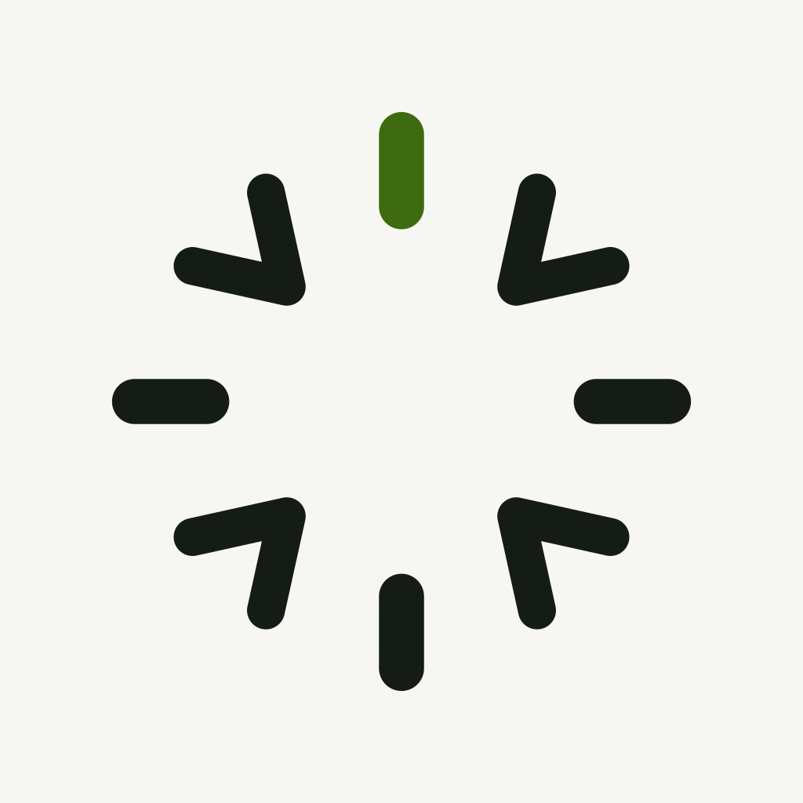

# Nexa

**Saiba o tempo de espera antes de sair de casa.**

Aplicativo que mostra, quase em tempo real, a espera nas unidades de saúde públicas (SUS) perto de você.

 

**[▶️ Assistir ao pitch (menos de 5 minutos)](https://youtu.be/CeRqUdq_1lY)**

---

## Sobre o projeto

Quem usa o SUS costuma sair de casa sem saber se a unidade está vazia ou lotada. O resultado é tempo perdido na fila, deslocamento em vão e pessoas procurando atendimento no lugar errado.

O **Nexa** resolve isso do lado do cidadão: o app encontra as unidades de saúde perto de você, mostra a **estimativa de espera** de cada uma e se atualiza sozinho. Com isso você escolhe aonde ir com informação, e não no palpite.

Na unidade, um **totem de check-in** (ESP32) registra a chegada do paciente por CPF e entrega a senha, e é essa chegada que alimenta a fila que o app mostra.

O projeto foi desenvolvido na **Global Solution FIAP 2026/2**, no desafio **CitizenTech**, e conecta com os Objetivos de Desenvolvimento Sustentável da ONU: **ODS 3** (Saúde e Bem-Estar) e **ODS 10** (Redução das Desigualdades).

---

## Repositórios

| Repositório | O que contém | Tecnologias |
| :--- | :--- | :--- |
| [**fe-nexa-app**](https://github.com/NexaGS/fe-nexa-app) | Aplicativo do cidadão: busca unidades, mostra a espera estimada, favoritas e conta | Flutter, Dart |
| [**nexa-springboot**](https://github.com/NexaGS/nexa-springboot) | API principal: autenticação, unidades, geolocalização e fila FIFO com senha e chamada automática | Java 21, Spring Boot, JPA, JWT |
| [**nexa-dotnet-gestao**](https://github.com/NexaGS/nexa-dotnet-gestao) | API de gestão: cadastro oficial de unidades por CNES, horários semanais e capacidade diária | .NET 10, ASP.NET Core, EF Core |
| [**oracle-database**](https://github.com/NexaGS/oracle-database) | Modelo relacional em 3FN (9 tabelas), scripts PL/SQL e carga nacional de unidades (cerca de 90 mil) | Oracle, PL/SQL |
| [**disruptive-architectures**](https://github.com/NexaGS/disruptive-architectures) | Totem de check-in com ESP32-S3, teclado, display OLED e simulação no Wokwi | C++ (Arduino), IoT |
| [**nexa-devops**](https://github.com/NexaGS/nexa-devops) | API Java e Oracle Free em contêineres, com Docker Compose numa VM Ubuntu na Azure | Docker, Azure CLI, Shell |
| [**quality-assurance**](https://github.com/NexaGS/quality-assurance) | Arquitetura da solução (ArchiMate), diagramas e documentação de qualidade | ArchiMate, documentação |

---

## Como as peças se conectam

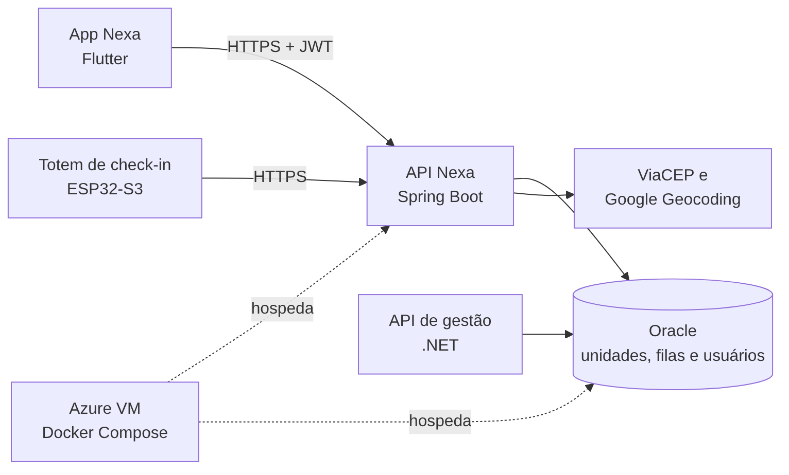

---

## Telas do app

| Início | Criar conta | Entrar |
| :---: | :---: | :---: |
| 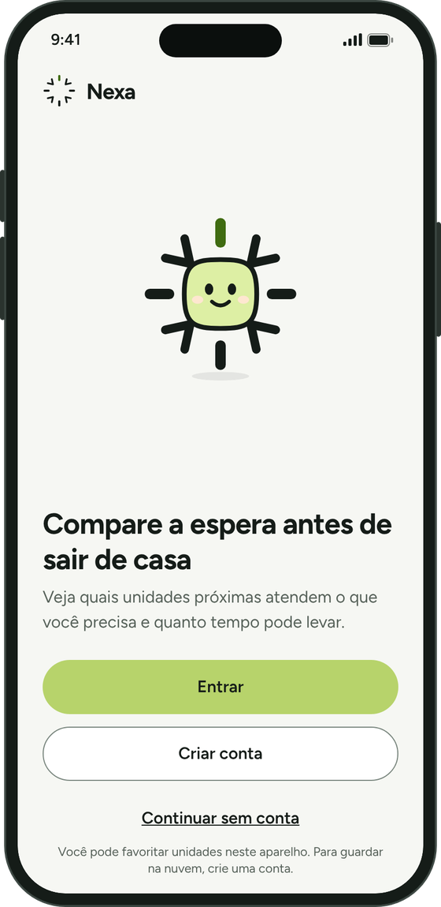 | 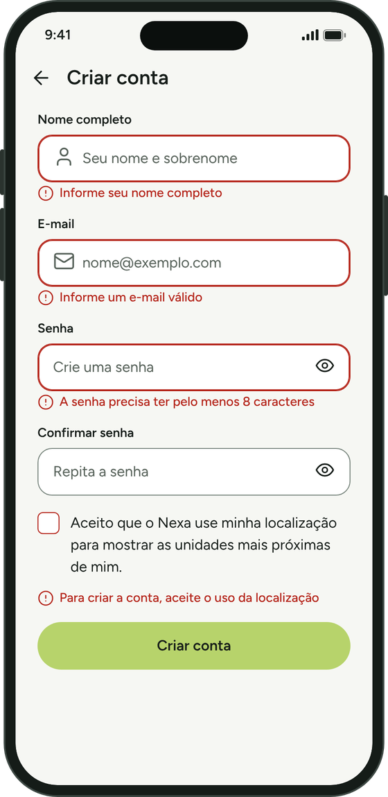 | 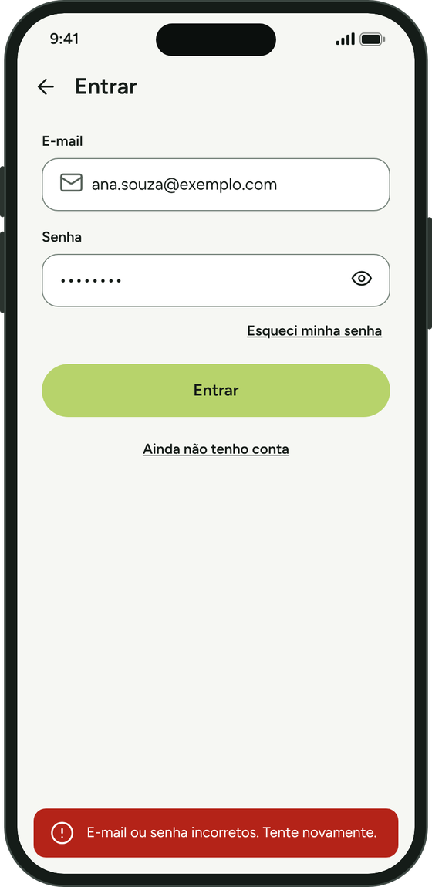 |

| Unidades perto de você | Detalhe da unidade | Como calculamos |
| :---: | :---: | :---: |
| 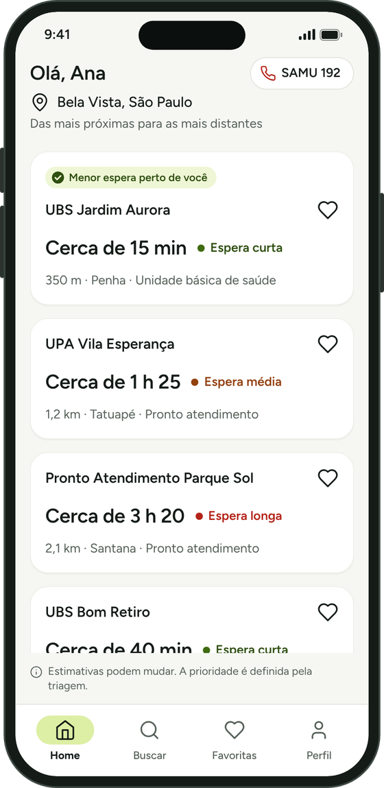 | 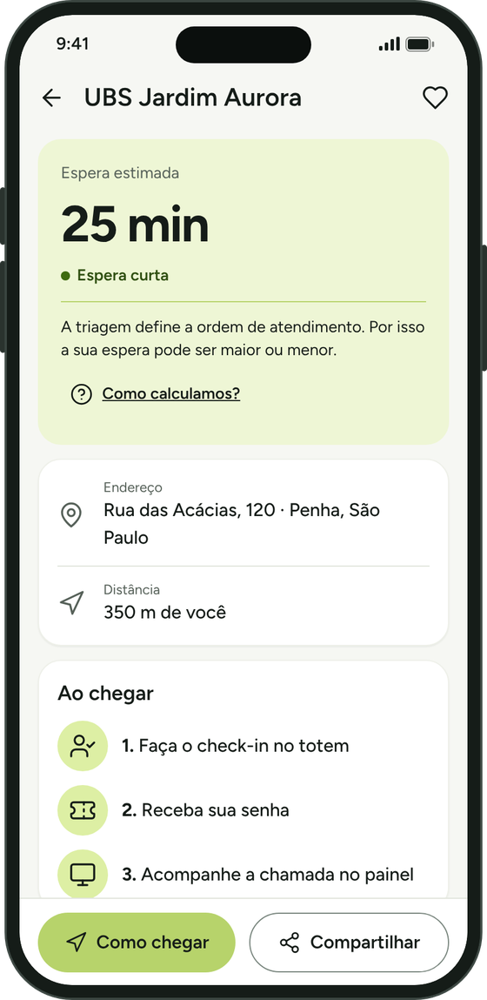 | 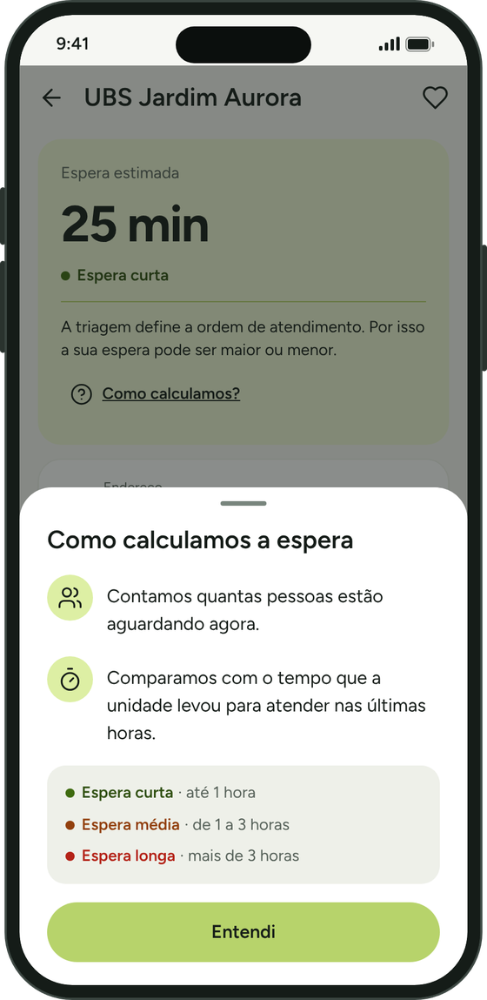 |

| Buscar | Favoritas | Perfil |
| :---: | :---: | :---: |
| 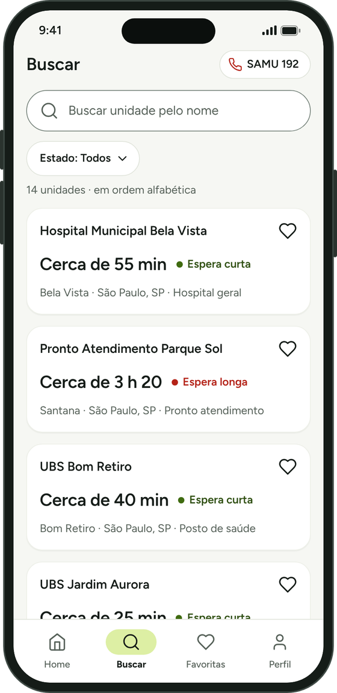 | 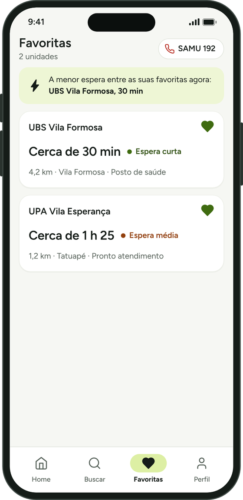 | 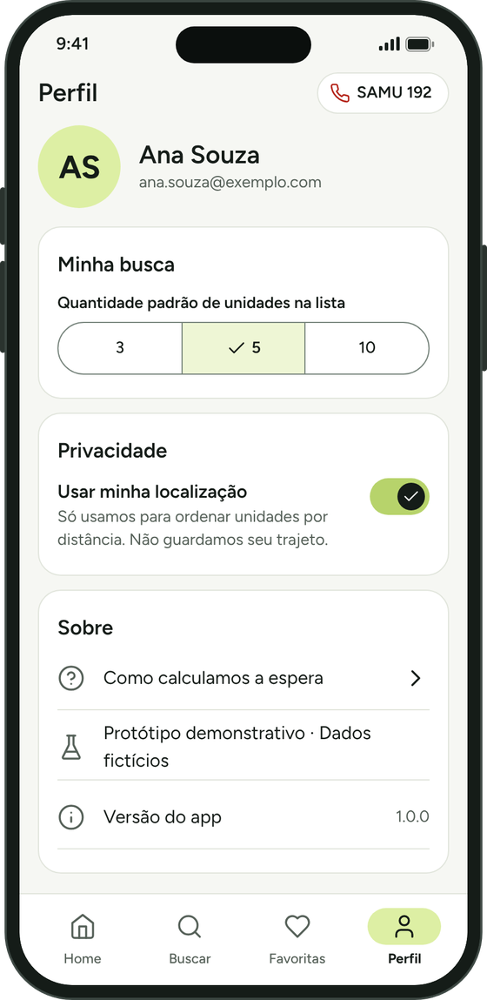 |

> As imagens são ilustrativas, geradas a partir do código das telas.

---

## O que o Nexa faz

- **Unidades perto de você:** usa a sua localização, com consentimento (LGPD), e ordena por proximidade.
- **Estimativa de espera:** mostra quantas pessoas há na fila e quanto tempo deve levar, e atualiza sozinha a cada 20 segundos.
- **Check-in no totem:** o paciente digita o CPF, escolhe o serviço e recebe a senha; a chegada entra na fila da unidade.
- **Busca e favoritas:** encontra qualquer unidade por nome e por estado e guarda as que você mais usa.
- **Gestão das unidades:** uma API separada cuida do cadastro oficial, dos horários e da capacidade.
- **Transparência:** a tela "Como calculamos" explica de onde vem a estimativa.

---

## Modelo de negócio

O app é **gratuito para o cidadão**. Quem paga é a **gestão pública**, que ganha dados de fluxo para distribuir melhor equipes e recursos. A API de gestão em .NET já cobre o cadastro e a capacidade das unidades; um painel visual para o gestor é o próximo passo.

---

## Equipe

| Nome | RM | Turma |
| :--- | :---: | :---: |
| Paulo Cavalcante Caroba | RM566667 | 2TDSPS |
| Renan da Silva Paulino | RM566610 | 2TDSPS |
| Sergio Henrique da Silva Santos | RM567254 | 2TDSPS |

---

Feito na **FIAP** · Global Solution · CitizenTech

